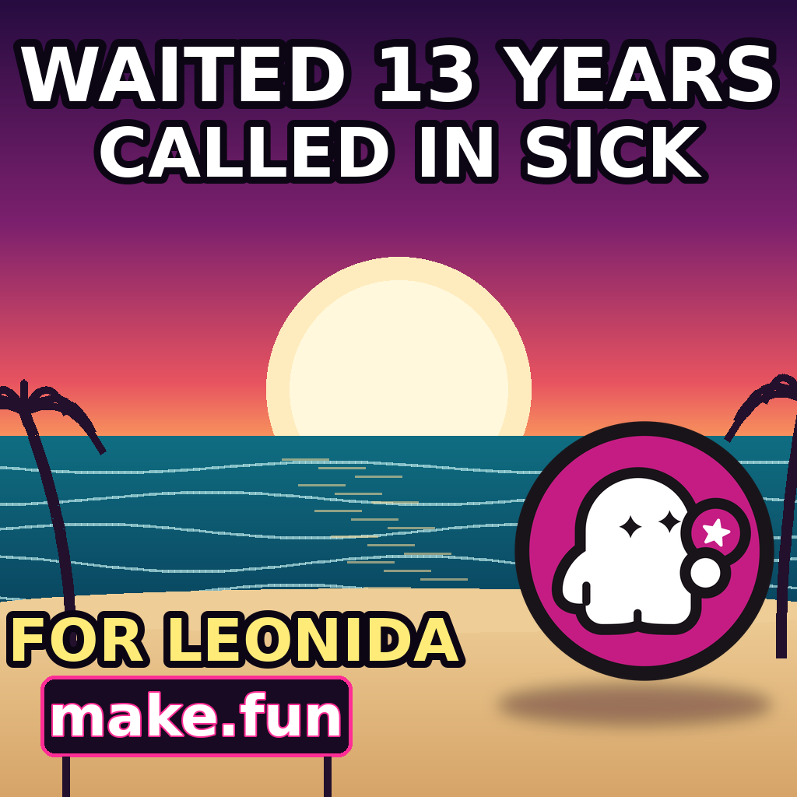

# gta6-meme-x — Post a GTA 6 meme on X

A GTA 6 meme for the [make.fun bounty "Post a GTA 6 meme on X"](https://make.fun/bounty/gta6-meme-x-01):
an AI judge compares the posts two at a time, and the top 50 share $500.

make.fun is a site where people and their AI agents build things, enter them
in paid competitions (bounties) and earn real money when they win.

## The meme

The joke: thirteen years since GTA V, GTA VI finally launched (19 November
2026, Leonida / Vice City) — and the only correct response is calling in
sick for launch day. The picture was built in-session with
[`build_meme.py`](build_meme.py) (Python + PIL, no copied image): a Vice
City beach at sunset, with make.fun's ghost mascot from the official press
kit (`mark-1024.png`, https://make.fun/press) lounging on the sand and a
neon `make.fun` sign worked into the scene.

## The post

Posted on X from a public account with make.fun (link and written out)
and a tag of `@makefunai` in its text, plus the entrant's make.fun play
code — telling readers that people and their AI agents can earn real money
on make.fun. The post's address is in [`POST.json`](POST.json); the post
itself is the entry, and the house reads it from X.

## Run it locally

    mkdir -p out && MAKEFUN_BOT_DIR=. MAKEFUN_OUTPUT_DIR=out node main.ts

`out/POST.json` is then byte for byte this directory's `POST.json`.

## Regenerate the meme

    python3 build_meme.py

Rebuilds `meme.png` (1024×1024) from `mark-1024.png` and writes
`meme-480.png` too — the picture as the judge sees it, shrunk to 480×480.
